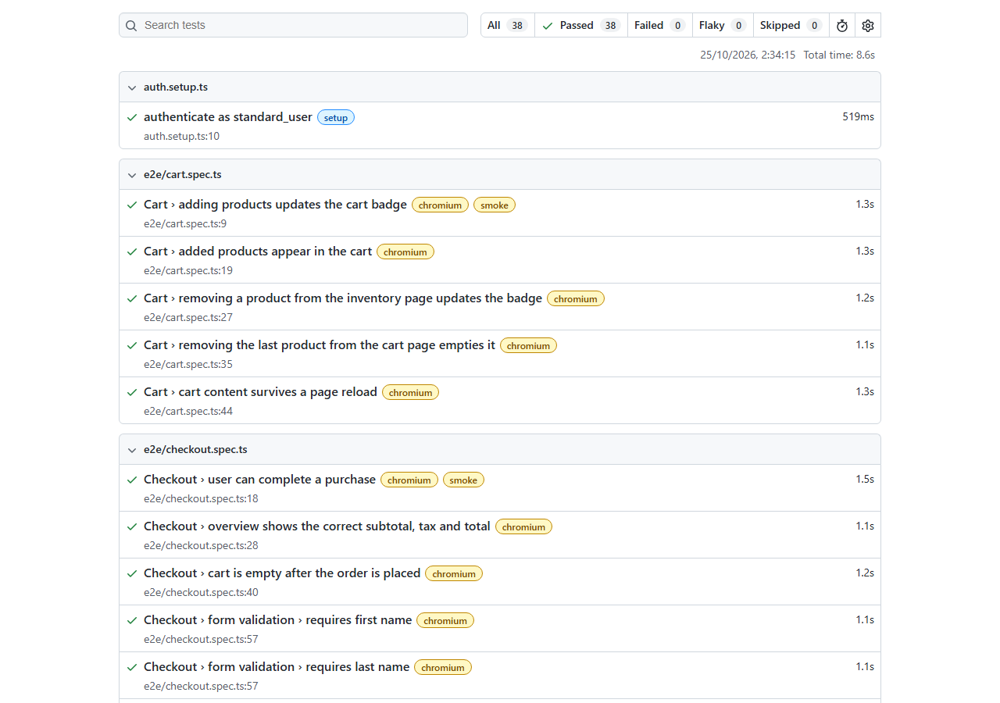

# Playwright Test Automation Portfolio

[](https://github.com/xdriim/playwright-portfolio/actions/workflows/playwright.yml)
[](https://xdriim.github.io/playwright-portfolio/)

End-to-end (UI) and API test suite written with **Playwright + TypeScript**, running on every push with **GitHub Actions** and publishing the HTML report to **GitHub Pages**.

- **UI under test:** [saucedemo.com](https://www.saucedemo.com), a public demo e-commerce site
- **API under test:** [dummyjson.com](https://dummyjson.com), a public demo REST API
- **Latest report:** https://xdriim.github.io/playwright-portfolio/



## What is tested

| Area | Spec | Covers |
| --- | --- | --- |
| Login | `tests/e2e/login.spec.ts` | Successful login, logout, 5 negative cases (locked user, wrong password, unknown user, empty fields), access to protected pages without a session |
| Inventory | `tests/e2e/inventory.spec.ts` | Sorting by price (both directions) and by name |
| Cart | `tests/e2e/cart.spec.ts` | Add/remove products, cart badge, cart page content, persistence after reload |
| Checkout | `tests/e2e/checkout.spec.ts` | Full purchase, subtotal/tax/total calculation, cart emptied after order, required-field validation |
| Auth API | `tests/api/auth.spec.ts` | Login (valid/invalid), `GET /auth/me` with valid, missing and invalid token |
| Products API | `tests/api/products.spec.ts` | Pagination, response shape, 404, search, filter by category, create/update/delete |
| Carts API | `tests/api/carts.spec.ts` | Line and cart total calculation, filter carts by user |

UI tests run in **Chromium and Firefox**. Critical paths are tagged `@smoke`.

## Project structure

```
.
├── .github/workflows/playwright.yml   # CI: run tests, publish report to Pages
├── fixtures/
│   ├── pages.ts        # injects Page Objects into UI tests
│   └── api.ts          # logs in once per worker, provides an authenticated request client
├── pages/              # Page Object Model
│   ├── components/Header.ts
│   ├── LoginPage.ts
│   ├── InventoryPage.ts
│   ├── CartPage.ts
│   └── CheckoutPage.ts
├── test-data/          # users, products, customer data, expected error messages
├── tests/
│   ├── auth.setup.ts   # logs in through the UI once and saves the session
│   ├── e2e/            # UI tests
│   └── api/            # API tests
└── playwright.config.ts
```

## Running the tests

Requirements: Node.js 20+.

```bash
npm ci
npx playwright install --with-deps chromium firefox

npm test                 # everything
npm run test:e2e         # UI tests (Chromium + Firefox)
npm run test:api         # API tests only
npx playwright test --grep @smoke   # smoke tests only
npm run test:ui          # Playwright UI mode, good for debugging
npm run report           # open the last HTML report
```

## Design decisions

**Page Object Model.** Each page has a class that owns its locators and actions, so tests read like user steps (`inventoryPage.addToCart(...)`) and a UI change is fixed in one place. The header (cart icon, menu) appears on every page, so it is a separate component reused by the page objects. The three checkout screens are small and always used together, so they share one `CheckoutPage`.

**Custom fixtures instead of `new Page()` in every test.** `fixtures/pages.ts` extends Playwright's `test` so a test simply asks for what it needs: `async ({ cartPage, checkoutPage }) => ...`. Playwright only creates the fixtures a test uses.

**Log in once, reuse the session.** A `setup` project logs in through the UI and saves cookies and local storage with `storageState`. The UI projects depend on it, so most tests start directly on the inventory page. This is faster and keeps each test focused on what it tests. The login tests opt out with an empty `storageState` because logging in *is* what they test.

**Locators.** saucedemo.com exposes `data-test` attributes, so the config sets `testIdAttribute: 'data-test'` and the page objects use `getByTestId()`. Where a user-facing role is clearer (buttons inside a product card) `getByRole()` is used. No CSS or XPath selectors tied to layout.

**Test data separated from tests.** Users, products, customer data and the exact expected error messages live in `test-data/`. Negative cases are data-driven: one table of inputs and expected errors generates one test per row.

**Web-first assertions.** Assertions like `toHaveText` and `toBeHidden` retry until they pass or time out, so there are no manual waits or `sleep`s in the suite. Money is compared with `toBeCloseTo` to avoid floating-point issues.

**API tests with Playwright's `request`.** Same runner, same report and same CI as the UI tests, with no extra tool. A worker-scoped fixture logs in once per worker and gives tests an `authedRequest` client that already sends the `Bearer` token, similar to an environment variable holding the token in a Postman collection. Tests check status codes, response shape and business rules (for example, cart total = sum of line totals), not only that the call succeeds.

**CI.** The workflow type-checks the code, runs every project, and uploads the HTML report even when tests fail, since that is when it is most useful. Only `main` deploys the report to GitHub Pages. In CI tests retry up to 2 times and record a trace on the first retry; `forbidOnly` fails the build if a `test.only` is committed by mistake.

### Known limitations

- dummyjson.com simulates write operations: `POST`/`PUT`/`DELETE` return realistic responses but nothing is stored, so write tests verify the response and cannot read the change back.
- Both systems under test are public third-party demos. If one of them is down, the related tests will fail for reasons outside this repo.
